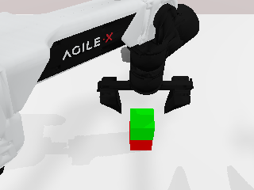

# RoboTwin WSL2 复现

在 Windows 的 WSL2 Ubuntu 22.04 中，通过 Docker 运行 RoboTwin：**CPU PhysX 物理、GPU 光栅相机渲染、CUDA 运动规划**。这一配置使用 Mesa Dozen 将 Vulkan 转到 D3D12，关闭光追，并对固定版本的 SAPIEN/SVulkan2 做兼容修改。

已在 RTX 4070 Ti SUPER 上运行真实 `stack_blocks_two + aloha-agilex` 专家演示：seed 0 的 8 个动作组全部成功，规划、关节范围和任务成功检查均通过。相机输出为 320 × 240 RGB。原环境保存为本地镜像后，已重建容器并重新验证 CUDA、相机渲染与依赖。



这是一个固定组合的实验性兼容方案。当前验证范围是无窗口 RGB 和一段专家演示；光追、CUDA 图形互通、GPU 点云、GUI、全部任务及策略训练不在这次验证范围内。相同版本的 RoboTwin 在原生 Linux 上默认也使用 CPU PhysX，并非本方案把物理后端降级为 CPU。

## 版本与运行条件

| 项目 | 成功环境 |
| --- | --- |
| Docker 底图 | `pytorch/pytorch:2.4.1-cuda12.1-cudnn9-devel`，通过 `docker.1ms.run` 拉取 |
| 容器系统 | Ubuntu 22.04，Linux amd64 |
| WSL 发行版 | Ubuntu 22.04 |
| GPU 与 Windows 驱动 | NVIDIA GeForce RTX 4070 Ti SUPER / 581.80 |
| Docker Desktop / Engine | 4.50.0 / 28.5.1，WSL2 后端 |
| WSL 内核 | `6.6.87.2-microsoft-standard-WSL2` |
| Python | 3.10.22，容器内独立 Conda 环境 |
| PyTorch / torchvision | `2.4.1+cu121` / `0.19.1+cu121` |
| SAPIEN | `3.0.0b1+wsldzn`，保留原 CUDA 编译能力 |
| cuRobo / PyTorch3D | `0.7.8` / `0.7.8` |
| Mesa Vulkan 驱动 | `25.0.7~kisak3~j`，DZN |
| NumPy / SciPy / MPLib | `1.26.4` / `1.10.1` / `0.2.1` |
| CUDA 编译架构 | `8.9`，与上述显卡对应 |

完整源码提交和镜像摘要见 [`source-lock.json`](source-lock.json)，成功环境中 279 个 Python 发行包的版本约束见 [`constraints.txt`](constraints.txt)。系统软件源和 Conda 底层构建仍会影响重建结果；这些文件不是逐字节一致的系统快照。

运行前需要：

- Windows NVIDIA 驱动已支持 WSL GPU；Ubuntu 中存在 `/usr/lib/wsl/lib/libd3d12.so`。
- Docker Desktop 使用 Linux containers、WSL2 后端，并启用所选 Ubuntu 发行版的 Docker 集成。
- Windows PowerShell 7，以及可访问 GitHub、PyTorch、Hugging Face、Conda Forge 和所用 APT 源的网络。
- 为镜像、源码、CUDA 编译缓存和本地快照预留数十 GB 磁盘空间。本次构建环境可用内存约 23 GiB，默认编译并行度为 2。

所有安装写入容器及本仓库 `workspace/`。脚本不安装 WSL 宿主的 Linux NVIDIA 驱动，不修改全局 Docker daemon 配置，也不重启或清理其他容器。

## 从底图安装

在 Windows PowerShell 7 中克隆本私有仓库，并进入仓库根目录：

```powershell
git clone https://github.com/Hongtauo/RoboTwin_WSL2.git
cd RoboTwin_WSL2
Copy-Item .env.example .env
./setup.ps1
```

如果 WSL 发行版名称不同，显式选择它：

```powershell
./setup.ps1 -Distro Ubuntu-22.04
```

默认使用 `robotwin-repro` 容器、`robotwin-wsl-repro` Compose 项目和 `robotwin-wsl:repro` 本地镜像，避免与原实验的 `robotwin` 容器冲突。可以在 `.env` 中修改名称和编译并行度；发行版通过 `-Distro` 参数选择。全部 Docker 操作在该 WSL 发行版中执行，`/usr/lib/wsl` 因而会解析为正确的 Linux 路径。

`setup.ps1` 执行以下顺序：

1. 用固定摘要的 PyTorch 底图创建初始容器，并只读挂载 WSL 驱动库与本仓库。
2. 运行 [`workspace/bootstrap_robotwin.sh`](workspace/bootstrap_robotwin.sh)，安装运行库、Mesa DZN 与编译工具，建立 Python 3.10 环境，并检出固定源码。
3. 复用底图中与 PyTorch 2.4.1 匹配、无 CPython ABI 依赖的 NVIDIA 库，安装真正的 Python 3.10 PyTorch、torchvision 和 Triton wheels。
4. 应用源码补丁，编译 SAPIEN、cuRobo 和 PyTorch3D，安装 XPolicyLab 共享模块。
5. 下载并校验约 220 MB 的官方 `embodiments.zip`，仅提取 `aloha-agilex`，生成容器内绝对路径配置。
6. 验证 CPU 物理、GPU 渲染、CUDA 运算，并执行一次真实堆方块专家演示。
7. 只有前面全部成功，才把容器保存为本地镜像、重建容器，再检查默认 Python、CUDA、渲染和 `pip check`。

日志写入被 Git 忽略的 `logs/`。下载与首次编译需要较长时间；`docker commit` 保存期间会暂停该容器，本次原环境约耗时十分钟，无进度条并不直接表示失败。重建不会保存进程状态，保存的是容器文件系统和镜像配置。

本入口把已经成功执行过的分步过程串联为脚本。仓库中的真实结果来自原分步安装及快照验证；本次整理没有额外执行一轮从空底图开始的完整编译。新增入口的检查结果与原任务记录分别保留，不能把静态检查解释为新的完整冷启动成功。

整理后的 `validate.ps1 -PlayOnce` 已在独立临时 GPU 容器中实际通过：使用现有运行时快照和只读原任务源码，验证本仓库中的检查脚本、CUDA、光栅出图、依赖及 seed 0 专家演示。具体范围见 [`packaging-validation.json`](evidence/packaging-validation.json)。

## 启动与验证

安装完成后进入容器：

```powershell
./start.ps1 -Enter
```

容器内默认 `python` 指向 `/opt/conda/envs/robotwin/bin/python`。再次执行真实演示：

```bash
python /workspace/check_robotwin_task.py --play-once
```

在 Windows 端执行基础验证或连同演示一起验证：

```powershell
./validate.ps1
./validate.ps1 -PlayOnce
```

基础验证包括 PyTorch CUDA 运算、SAPIEN 物理及 GPU 光栅出图、PyTorch3D GPU KNN、cuRobo GPU 正向运动学和依赖完整性。`-PlayOnce` 额外检查任务自身成功判据、规划状态及关节范围。测试输出写入 `workspace/diagnostics/`，不会进入 Git。

单独检查初始场景可在容器中运行：

```bash
python /workspace/check_robotwin_task.py
```

`check_robotwin_task.py` 使用内置最小配置：关闭随机背景、杂物、深度、分割、点云和腕部相机采集，仅使用头部 RGB。不搜索无限 seed，不导入数据采集主循环，也不调用语言生成服务。

## 恢复中断与保留数据

安装失败后保留当前容器和工作区，修复报错后再次运行 `setup.ps1`。同一底图的部分安装容器会继续使用，已完成的原生库和源码缓存保留；补丁在写入前检查固定源码。已配置的容器不会被重新换回底图。

如果同名容器属于其他项目或其他 checkout，脚本会拒绝操作。要建立独立环境，在 `.env` 中选择新的项目名、容器名和镜像 tag。不要通过删除原容器来绕过保护。

PowerShell 入口会计算本 checkout 的归属标签，并检查同一 Compose 项目下的全部现有服务容器。请通过这些入口启动；直接运行 `docker compose up` 缺少所需的 checkout 标识。

保存后的本地镜像仍需要本 checkout 的 `workspace/`：RoboTwin 源码和机器人资产位于 bind mount 中，不包含在 `docker commit` 镜像层内。备份时应同时保留镜像与工作区。当前 SAPIEN wheel 还依赖镜像内 `/opt/robotwin-build/SAPIEN/sapien_build/_sapien_install/lib` 的动态库；保留 `/opt/robotwin-build`，不能只拷贝 wheel 当作独立安装包。

## 补丁与构建文件

| 文件 | 用途 |
| --- | --- |
| [`patch_svulkan2_static_cull.py`](patches/patch_svulkan2_static_cull.py) | 移除 DZN 缺失的动态剔除扩展依赖，保持四种面剔除模式的静态 pipeline 选择 |
| [`patch_robotwin_raster.py`](patches/patch_robotwin_raster.py) | 给 RoboTwin 增加 `ROBOTWIN_CAMERA_SHADER=default` 选择 |
| [`patch_lazy_clutter.py`](patches/patch_lazy_clutter.py) | 清洁场景导入时不提前读取完整杂物资产库 |
| [`patch_builddeps.py`](patches/patch_builddeps.py) | 固定 CUDA 架构，修复 TinyXML 下载入口并保留原校验 |
| [`patch_pybind11_pin.py`](patches/patch_pybind11_pin.py) | 将已不存在的 `smart_holder` 分支固定到兼容归档提交及 SHA256 |
| [`patch_pinocchio_submodules.py`](patches/patch_pinocchio_submodules.py) | 只初始化编译需要的 CMake 子模块，跳过未使用的样例机器人库 |
| [`patch_robotwin_optional.py`](patches/patch_robotwin_optional.py) | 执行上游安装流程中的 URDF UTF-8 和 MPLib 兼容调整 |
| [`reuse_cuda_wheels.py`](patches/reuse_cuda_wheels.py) | 校验并复用 NVIDIA 通用库，独立复制发行包元数据 |

[`bootstrap_smoke.sh`](workspace/bootstrap_smoke.sh) 保留原调查阶段的 PyPI SAPIEN 探针，新安装入口不依赖在 base Python 3.11 中安装该 wheel。标准安装由 `bootstrap_robotwin.sh` 决定顺序。更多实现说明见[兼容性与验证范围](docs/compatibility.md)，具体故障与修复见[故障排查](docs/troubleshooting.md)。

## 真实验证证据

[`evidence/validation-summary.json`](evidence/validation-summary.json) 汇总硬件、版本、已完成检查和边界。核心文件包括：

- [`robotwin_task.json`](evidence/robotwin_task.json)：真实任务结果，8 个成功 move 组、12 段规划、2882 个 waypoint，关节最大越界量为 0 rad。
- [初始相机图像](evidence/robotwin_initial.png)与[最终相机图像](evidence/robotwin_final.png)：原始 PNG 字节，未重新编码。
- [`snapshot-roundtrip.json`](evidence/snapshot-roundtrip.json)：镜像保存与重建后的基础验证范围。
- [`provenance.json`](evidence/provenance.json)：原始文件摘要及隐私字段处理说明。

原任务报告总耗时约 42.12 秒，包含初始化、规划器预热及相机观测，是一次运行记录，不是帧率基准，也没有原生 Linux 对照。报告移除了本机绝对路径、容器实例 ID 和唯一设备标识，保留测量数值。Git 不包含完整运行日志、模型/机器人大资产、下载缓存、wheels、镜像层或凭据。

## 镜像下载备用工具

优先使用 `setup.ps1` 的标准 Docker 拉取路径。若标准拉取受网络限制，可在已有 Python 3 的机器上使用原实验的可选下载器：

```powershell
python ./tools/download_image.py
docker load -i ./tools/downloads/pytorch-2.4.1-cu121.oci.tar
```

它从 Docker Hub 匿名读取固定底图，校验 manifest/config 和各 blob 的 SHA256，生成 OCI archive，使用的 bearer token 只保留在进程内存中。它不会下载本仓库私有内容。大型文件保留在被忽略的 `tools/downloads/`。

如果 OCI 导入只建立了本地 tag，没有建立 `tag@digest` 引用，可在 `.env` 中把 `ROBOTWIN_BASE_IMAGE` 设置为导入后的本地引用，并先用 `docker image inspect` 核对。`source-lock.json` 同时记录 manifest 与 config digest；二者不是可以随意互换的 image ID。该备用导入路径需要 Docker 支持 OCI archive，原环境使用 containerd image store。

## 上游项目

本仓库保存复现脚本、兼容补丁和小型证据，上游源代码、镜像和资产按各自许可证使用：

- [RoboTwin](https://github.com/RoboTwin-Platform/RoboTwin)
- [SAPIEN](https://github.com/haosulab/SAPIEN) 与 [SVulkan2](https://github.com/haosulab/sapien-vulkan-2)
- [cuRobo](https://github.com/NVlabs/curobo) 与 [PyTorch3D](https://github.com/facebookresearch/pytorch3d)
- [RoboTwin 官方资产](https://huggingface.co/datasets/TianxingChen/RoboTwin2.0)
